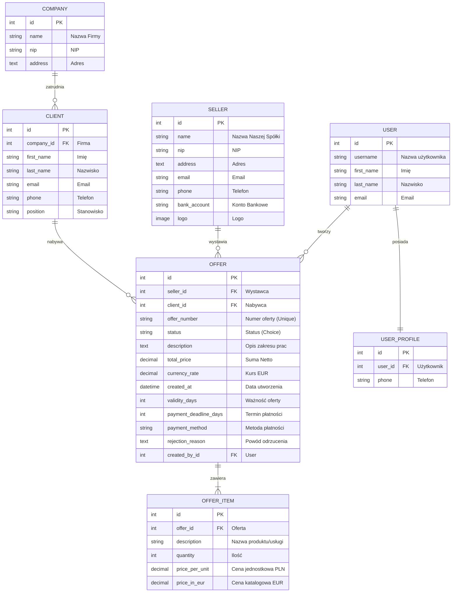

# System Ofertowania B2B (Django + React)

Aplikacja webowa do tworzenia i obsługi ofert handlowych B2B z prostym modułem CRM. Projekt powstał, żeby zastąpić ręczne klepanie kosztorysów w Excelu i uporządkować proces akceptacji ofert między handlowcem, działem IT a szefem (CEO).

Aktualnie projekt jest w trakcie przebudowy do **wersji 2.0** – przeszedłem z klasycznych szablonów HTML w Django na osobne REST API (Django REST Framework + PostgreSQL) oraz frontend w React + TypeScript.

## Struktura projektu

Projekt jest podzielony na dwa główne foldery:
* `offert_system_backend/` – backend w Pythonie (Django, DRF, generowanie PDF, testy w pytest, Docker)
* `offert_system_frontend/` – frontend w React + TypeScript (Vite)

## Technologie

**Backend:**
* Python 3.11 / Django 5
* Django REST Framework + SimpleJWT (logowanie tokenami JWT)
* drf-spectacular (dokumentacja Swagger pod `/api/docs/`)
* PostgreSQL 15 (uruchamiany w kontenerze Dockera)
* WeasyPrint (generowanie gotowych plików PDF z ofertą i logo firmy)
* pytest + pytest-django (testy jednostkowe i API)

**Frontend (w trakcie budowy):**
* React 19 + TypeScript (Vite)
* Axios (komunikacja z API + interceptor podpinający token JWT)

## Główne funkcje

* **Baza CRM**: zarządzanie firmami klientów, osobami kontaktowymi oraz danymi własnych spółek (wystawców ofert wraz z logo).
* **Kalkulacja kwot**: automatyczne przeliczanie wartości netto, podatku VAT (23%) i kwoty brutto na podstawie pozycji kosztorysu (oparte na typie `Decimal` i sygnałach Django).
* **Numeracja ofert**: automatyczne nadawanie kolejnych numerów w formacie `nr/MM/RRRR` w ramach danego miesiąca.
* **Obieg statusów (Workflow) i uprawnienia**:
  * Handlowiec tworzy szkic oferty (`draft`), może go wysłać do konsultacji technicznej IT (`consultation`) albo do akceptacji CEO (`pending`).
  * Po wysłaniu oferty jej edycja jest blokowana.
  * CEO (superuser) może zatwierdzić ofertę (`approved`) lub ją odrzucić (`rejected`) z podaniem powodu odrzucenia, po czym handlowiec może cofnąć ją do poprawy.
* **Eksport do PDF**: generowanie dokumentu PDF z tabelą pozycji, warunkami płatności, logo wystawcy i danymi kontaktowymi handlowca (imię, nazwisko, email, telefon z profilu użytkownika).

## Schemat bazy danych



## Jak uruchomić projekt lokalnie

### 1. Backend (Docker)

Wymagany zainstalowany Docker / OrbStack.

```bash
cd offert_system_backend
cp .env.example .env
```
*(W pliku `.env` ustaw hasło do bazy `POSTGRES_PASSWORD`).*

Uruchomienie kontenerów i migracja bazy:
```bash
docker compose up -d --build
docker compose exec web python manage.py migrate
docker compose exec web python manage.py createsuperuser
```

Dostępne adresy backendu:
* API: `http://localhost:8000/api/`
* Dokumentacja Swagger: `http://localhost:8000/api/docs/`
* Panel Admina: `http://localhost:8000/admin/`

Uruchomienie testów:
```bash
docker compose exec web pytest
```

### 2. Frontend (React + TS)

W drugim terminalu:
```bash
cd offert_system_frontend
npm install
npm run dev
```
Aplikacja frontendowa uruchomi się pod adresem `http://localhost:5173/`.

## Planowane w wersji 2.0 (TODO)
* Rozbudowa widoków w Reactcie (formularz tworzenia ofert, zmiana statusów, pobieranie PDF z poziomu UI).
* Integracja z API NBP (automatyczne kursy walut) oraz eksport danych pod KSeF.
* Moduł AI pomagający wygenerować pozycje kosztorysu na podstawie wiadomości od klienta.
